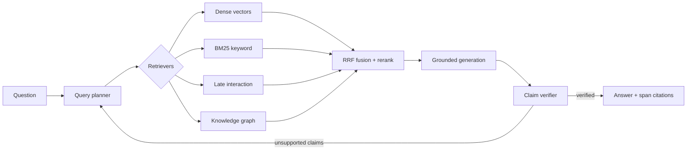

<p align="center">
  
</p>

<p align="center">
  <b>Evidence-first agentic RAG.</b><br>
  Hybrid + graph retrieval, query planning, and claim-level verification —<br>
  every answer is traceable to the exact source span it came from.
</p>

<p align="center">
  
  
  
  
  
</p>

---

## Why Provena?

Most RAG systems retrieve some chunks, hand them to an LLM, and hope the answer is right.
Provena treats every answer as a set of **claims that must be proven**:

1. **Plan:** break the question into sub-questions.
2. **Retrieve:** search several ways at once (semantic, keyword, late-interaction, knowledge graph).
3. **Verify:** check each generated claim against the exact passage that supports it.
4. **Cite:** return the answer with span-level citations, and flag or drop anything unsupported.

If the evidence isn't there, Provena says so instead of guessing.

## Features

| | |
|---|---|
| 🧩 **Structure-aware ingestion** | Splits documents by headings, tables, and sections, and gives each chunk context from its surrounding document |
| 🔎 **Hybrid retrieval** | Dense vectors + BM25 + ColBERT-style late interaction, fused with Reciprocal Rank Fusion and cross-encoder reranking |
| 🕸️ **Graph retrieval** | Entity and relation graph for questions that need several hops |
| 🧠 **Query planner** | Decomposes complex questions into parallel sub-queries |
| ✅ **Claim-level verification** | Every sentence in the answer is checked against its source span |
| 📍 **Precise citations** | Page, section, character offsets, and bounding boxes; built from metadata, never guessed by the model |
| 📊 **Eval from day one** | Golden test set and regression gates in CI: quality can't silently drop |
| 🏢 **Production-ready** | Multi-tenant access control, streaming, per-query cost/latency budgets, OpenTelemetry tracing |
| 🖥️ **Citation viewer UI** | Click a citation, see the highlighted source passage |

## Architecture



## Roadmap

- [x] **Foundation**: project layout, config, logging, health checks, CI
- [ ] **Ingestion**: loaders (PDF, DOCX, Markdown, HTML), structure-aware chunking
- [ ] **Evaluation harness**: golden dataset and CI regression gates
- [ ] **Retrieval**: dense + BM25 + RRF, then reranking and late interaction
- [ ] **Agentic layer**: query planner, LangGraph orchestration, retry budgets
- [ ] **Verification**: claim extraction, span matching, abstention
- [ ] **Graph retrieval**: entity/relation extraction and multi-hop search
- [ ] **Production**: multi-tenancy, streaming, cost budgets, tracing
- [ ] **UI**: citation viewer

## Quick start

Requires Python 3.12+ and [uv](https://docs.astral.sh/uv/).

```bash
git clone https://github.com/HemashreeVI/provena.git
cd provena
uv sync                 # install dependencies
cp .env.example .env    # optional: adjust settings
uv run provena          # http://localhost:8000/docs
```

Or run the API together with Qdrant in Docker:

```bash
docker compose up --build
curl localhost:8000/ready
```

### Development

```bash
make check   # lint + strict type check + tests (what CI runs)
make fmt     # auto-fix formatting
```

See [docs/architecture.md](docs/architecture.md) for the design and code layout.

## Contributing

Ideas, issues, and pull requests are welcome. Open an issue to start a discussion.

<p align="center">
  
</p>
